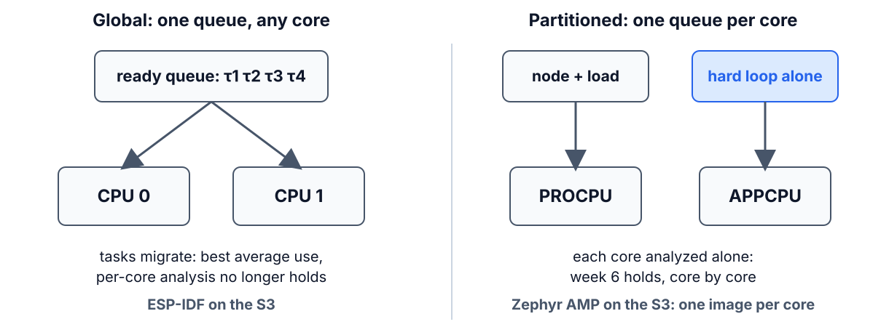
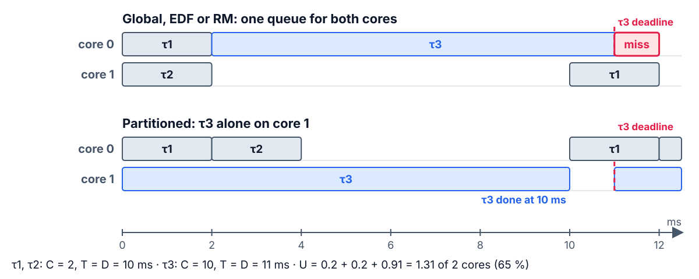
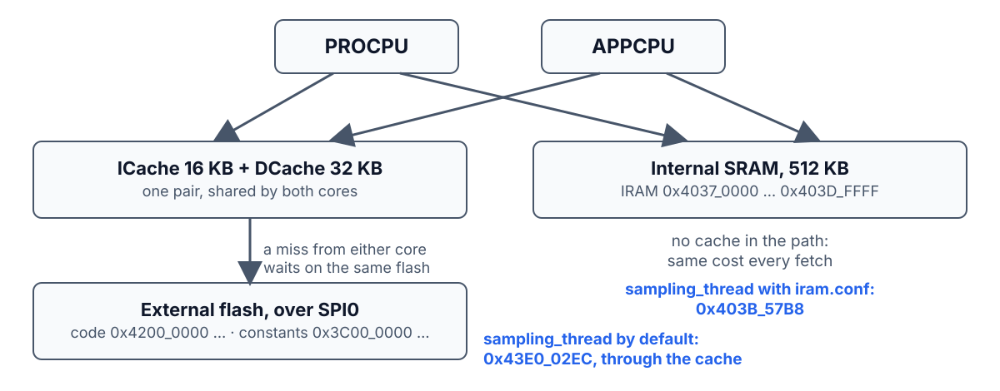
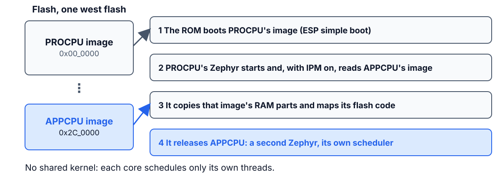
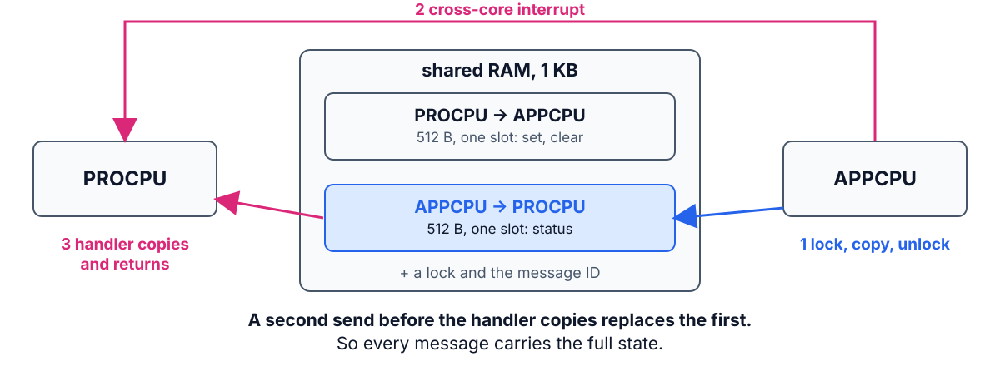
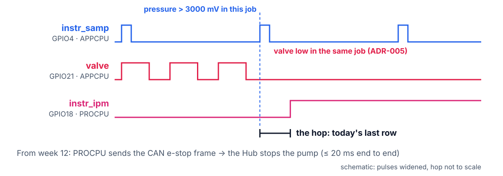
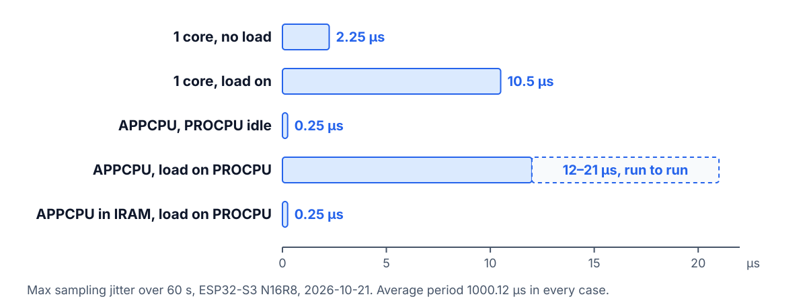

<!--
theme: course
paginate: true
title: FreeRTOS, multicore, WCET
style: |
  section { --course: #0d9488; }
-->

<!-- _class: lead -->
<!-- _paginate: false -->

# FreeRTOS, two cores, and the worst case

**Week 8** · the industry's kernel, honestly; partitioning on the S3; where C_i comes from

A customer demands FreeRTOS, and the hard loop gets its own core. What do you actually gain?

<!--
0:00–1:30. This is FreeRTOS's dedicated session: the weekly aside becomes the
headline. Then the S3's second core, and an honest look at the C_i column we've
been filling since week 2. Today the node becomes the project's node.
-->

---

<!-- _class: agenda -->

## Today

1. **FreeRTOS**: the map, the code, the verdict
2. **Multicore**: global or partitioned, and the S3 inside
3. **WCET**: what measurement can and can't promise
4. **Guided build**: the project's node, split across the cores

By the end you can pick a kernel for a product, partition a task set across cores, and read a tail table by its maxima.

<!--
1:30–2:30. Reading: Buttazzo §13.1–13.2, §13.5; §2.4 as the multiprocessor hook.
FreeRTOS isn't in the book: the official docs and Barry's free book are the
reference. Multiprocessor scheduling isn't either: Davis & Burns (2011) is.
-->

---

<!-- _class: s1 -->
<!-- _header: 1 · FreeRTOS -->

## Everything you learned transfers

| Zephyr | FreeRTOS |
|---|---|
| `K_THREAD_DEFINE` | `xTaskCreate` |
| `k_msgq` | `xQueue` |
| `k_sem` / `k_mutex` | semaphore / mutex with inheritance |
| `k_work` | timer-daemon task, or a worker of your own |

<!--
2:30–4:30. Build the right column with the class. One habit flip from week 3:
FreeRTOS priorities count up (0 is idle), Zephyr's count down.
-->

---

<!-- _class: s1 -->
<!-- _header: 1 · FreeRTOS -->

## The same sampling thread, two kernels

```c
/* Zephyr: the node today */
K_MSGQ_DEFINE(tick_q, sizeof(uint32_t), 8, 4);
k_msgq_put(&tick_q, &now, K_NO_WAIT);                    /* timer ISR */
K_THREAD_DEFINE(samp, 1536, sampling, NULL, NULL, NULL, 2, 0, 0);
```

```c
/* ESP-IDF FreeRTOS */
QueueHandle_t tick_q = xQueueCreate(8, sizeof(uint32_t));
xQueueSendFromISR(tick_q, &now, &woken); portYIELD_FROM_ISR(woken);
xTaskCreatePinnedToCore(sampling, "samp", 2048, NULL, 20, NULL, 1);
```

Priority 20 is **high** here · ISRs call `…FromISR` · the last argument pins the task to core 1

<!--
4:30–7:30. Walk the three lines pair by pair. The loop body (wait on the queue,
run task_sampling) is identical in both.

Point at three differences:
- The ISR API. FreeRTOS has separate ISR variants; `woken` reports whether a
  higher-priority task became ready, and `portYIELD_FROM_ISR` switches to it on
  exit. In Zephyr, `k_msgq_put` with K_NO_WAIT is ISR-safe and the kernel
  reschedules on exit by itself.
- The stack. ESP-IDF counts it in bytes; vanilla FreeRTOS counts words.
- The last argument. 1 is APP_CPU, 0 is PRO_CPU, and `tskNO_AFFINITY` lets the
  scheduler run the task on either core. That last option is the SMP Zephyr
  doesn't offer on the S3.

Misconception: "porting is a rewrite". It's a mapping, plus the ISR discipline.
-->

---

<!-- _class: s1 -->
<!-- _header: 1 · FreeRTOS -->

## Where each one wins

| FreeRTOS | Zephyr |
|---|---|
| tiny, and in every vendor SDK | one toolchain across chips (devicetree) |
| SMP on this S3, through ESP-IDF | no SMP on the S3: AMP only |
| — | EDF; drivers, shell and logging built in |

<!--
7:30–9:30. Honest weaknesses of FreeRTOS: no devicetree (portability means an
SDK change), no EDF, fewer built-in services. Honest weakness of Zephyr here: no
SMP on the S3 (the pinned tree has SMP for the original ESP32, not this chip).
-->

---

<!-- _class: s1 question -->
<!-- _header: 1 · FreeRTOS -->

## Product A: this S3, radio on, both cores squeezed. Product B: a family on three vendors' chips. Which kernel for which?

1. FreeRTOS for both: it's the industry standard
2. A: ESP-IDF/FreeRTOS · B: Zephyr
3. A: Zephyr · B: FreeRTOS
4. Zephyr for both: it has EDF

<!--
9:30–11:30. Vote, discuss in pairs, vote again. Answer: 2. A wants the vendor's
mature SMP and radio stack on one chip; B wants one toolchain and devicetree
across silicon. 1 and 4 pick a kernel before reading the product.
-->

---

<!-- _class: s2 figure -->
<!-- _header: 2 · Multicore -->

## Global or partitioned



<!--
11:30–14:00. Global: one queue, the scheduler runs the m highest-priority ready
tasks on m cores, and tasks migrate. Best average use of the cores, but
migration costs and cache effects, and the week-6 analysis no longer applies as
it stands. Partitioned: each task pinned to one core, one queue per core. On the
S3, Zephyr gives us partitioned by construction: one image per core, the hard
loop alone on APPCPU.
-->

---

<!-- _class: s2 figure -->
<!-- _header: 2 · Multicore -->

## Global scheduling can miss at 65 % load



<!--
14:00–17:00. Dhall's effect (Dhall & Liu, 1978), with numbers. Two light tasks
have the earlier deadlines, so global EDF (or RM: their periods are shorter too)
gives them both cores at t = 0. The heavy task τ3 starts at 2 ms, needs 10, ends
at 12, and its deadline was 11. Two cores are only 65 % loaded. Partitioned: τ3
alone on core 1 finishes at 10, and τ1 and τ2 share core 0 at U = 0.4.

The general result: with m cores, global RM or EDF can miss with a total load
just above 1, however large m is. Newer global algorithms avoid it, but their
analysis is harder (Davis & Burns 2011 survey both families). That's one reason
hard real-time designs usually pin their tasks.

Misconception: "more cores, more headroom". Only if the tasks can use them.
-->

---

<!-- _class: s2 -->
<!-- _header: 2 · Multicore -->

## Partitioned: pack the tasks, then run week 6 on each core

- Assign tasks to cores like packing bins: **heaviest first**, into the first core where it fits
- Each core then passes its own test: U ≤ U_lub, or RTA
- No migration: each core is analyzed alone, with week 6 unchanged
- Our node: two bins, and one holds only the hard loop

<!--
17:00–19:00. Partitioning is bin packing, NP-hard in general; first-fit
decreasing by utilization is the usual heuristic (Davis & Burns). Once
packed, every uniprocessor result applies core by core: RM bound, EDF's U ≤ 1,
RTA with blocking.

The analysis assumes the cores don't disturb each other through hardware they
share. Leave that open: ask the room what the two S3 cores share, and don't
answer it. The lab tests it.
-->

---

<!-- _class: s2 figure -->
<!-- _header: 2 · Multicore -->

## Inside the S3: two cores, one cache in front of the flash



<!--
19:00–21:30. Datasheet v2.2, §4.1.2.3: "an instruction cache and a data cache
shared by the two CPU cores" (16 KB and 32 KB as Zephyr configures them). Code
and constants live in external flash and reach either core through those caches
and the SPI0 controller. Internal SRAM (512 KB) is read directly: no cache in
the path, the same cost every time.

Point at the addresses: they are the Step 4 check. The default build puts
sampling_thread at 0x43E0_02EC, in flash; with iram.conf it sits at 0x403B_57B8.
Callback to week 2: the L476 with its cache off had a fixed cost per fetch too.

Misconception: "two cores means two of everything". Not on this chip.
-->

---

<!-- _class: s2 figure -->
<!-- _header: 2 · Multicore -->

## Two images, one flash: PROCPU starts APPCPU



<!--
21:30–23:30. Sysbuild builds two Zephyr applications: APPCPU's first, since
PROCPU's image needs to know where it lives. One `west flash` writes both: PROCPU
at 0x0, APPCPU at 0x2C0000. At boot PROCPU's Zephyr loads and releases APPCPU
(soc/espressif/esp32s3/esp32s3-mp.c), and only when the PROCPU image enables IPM:
that is the SOP's "second core not started" troubleshooting row.

Two kernels share nothing: a `k_msgq` can't cross from one core to the other.
So how do they talk? Next slide.
-->

---

<!-- _class: s2 figure -->
<!-- _header: 2 · Multicore -->

## IPM: one slot each way, so every message carries the whole state



<!--
23:30–26:00. drivers/ipm/ipm_esp32.c: 1 KB of shared RAM split into two halves,
one per direction. The sender takes a lock, copies, releases it, and raises an
interrupt on the other core; the handler there runs in ISR context and gets a
pointer into the slot.

A second send before the handler copies the slot overwrites the first. So the
node never sends events like "e-stop happened": it sends `struct node_status`
(common/node_ipm.h) with the pressure, setpoint, duty, e-stop flag and peaks.
Losing a message then costs freshness, not state. The handler copies and
returns, as every ISR since week 4.

Misconception: "IPM is a queue across cores". It's a mailbox with one slot.
-->

---

<!-- _class: s2 question -->
<!-- _header: 2 · Multicore -->

## The hard loop moves alone to the second core, and the other core idles. What changes most?

1. Its average jitter halves
2. It runs twice as fast
3. Its rare worst-case spikes disappear
4. Nothing: one core was enough

<!--
26:00–28:00. Answer: 3. Misconceptions: "two cores, twice the capacity" (1, 2).
Averages barely move; what a dedicated core buys is the tail. Don't open the
case with a load on the other core: that is a prediction in the lab, and the
reveal comes after Step 4 (last slide).
-->

---

<!-- _class: s3 figure -->
<!-- _header: 3 · WCET -->

## What each method bounds


<!--
28:00–31:00. After Wilhelm et al. (2008), Fig. 1. Static analysis gives a safe
bound but needs a model of the cache and pipeline, and explodes on the S3's flash
cache. Pure measurement is cheap and can miss the worst path. The industry default
is the high-water mark under stress plus an engineering margin: that is the RET's
C_i column, and today's synthetic load is what makes the high-water mark honest.
-->

---

<!-- _class: s3 question -->
<!-- _header: 3 · WCET -->

## Why is static WCET easier on the L476 with its cache off than on the S3?

1. The L476 is slower
2. Without a cache, every fetch costs the same: no history to model
3. The S3 has two cores
4. Static analysis only supports ARM

<!--
31:00–33:00. Answer: 2: week 2's cache-off measurement, resurfacing. The S3
fetches from external flash through a cache, so an instruction's cost depends on
what ran before it.
-->

---

<!-- _class: s4 figure -->
<!-- _header: 4 · Guided build -->

## The e-stop now crosses the cores: measure the hop



<!--
33:00–35:00. Edwin's question. The valve still closes on APPCPU in the detecting
job (ADR-005), so REQ-ESTOP-01 doesn't change. What changes is who else learns
of it: PROCPU, and from week 12 the Hub through a CAN frame. The hop joins the
end-to-end budget at the kickoff (ADR-P2, ≤ 20 ms).

How it's measured (SOP-08 §3): trigger on GPIO18 rising; measure from the rising
edge of the instr_samp pulse that tripped. Five trips, keep the max.
-->

---

<!-- _class: s4 -->
<!-- _header: 4 · Guided build -->

## Today: predict, then build the node together

| Step | You measure | Predict now |
|---|---|---|
| 3 | Max jitter, one core, load on | ____ µs |
| 3 | Max jitter on APPCPU, load on PROCPU | ____ µs |
| 4 | Same, hard path in IRAM | ____ µs |
| 3 | The hop, max of 5 trips | ____ µs |

Steps 1–2 bring both cores up and split the node. Each step's check passes before anyone moves on.

<!--
35:00–38:00. Predictions on paper before the boards come out. Then run each
step on the projector first (SOP-08), then the pairs. ADR-003 must cite the cost:
two images, no console on APPCPU, the hop, the IRAM it occupies. Checkpoint 1
runs this node with CAN on PROCPU.
-->

---

<!-- _class: takeaway -->

## The one thing to remember

> A dedicated core doesn't make the loop faster; it removes the spikes that came from sharing the CPU. Judge it by the max, never the average.

<!--
38:00–39:00. Read it aloud. It is the first line of ADR-003's context.
-->

---

## References

- Buttazzo, *Hard Real-Time Computing Systems*, 4th ed.: §13.1–13.2, §13.5; §2.4
- R. I. Davis and A. Burns, "A survey of hard real-time scheduling for multiprocessor systems", *ACM Computing Surveys* 43(4), 2011
- S. K. Dhall and C. L. Liu, "On a real-time scheduling problem", *Operations Research* 26(1), 1978
- R. Wilhelm et al., "The worst-case execution-time problem: overview of methods and survey of tools", *ACM TECS* 7(3), 2008
- Espressif, *ESP32-S3 Series Datasheet* v2.2, §4.1.2 (memory and cache); *ESP32-S3 Technical Reference Manual*, chapter *System and Memory*
- R. Barry, *Mastering the FreeRTOS Real Time Kernel* (free at freertos.org); ESP-IDF Programming Guide, *FreeRTOS (IDF)*
- Zephyr docs: *Sysbuild*; *IPM*; the `ipm_esp32` sample

<!--
39:00–40:00. Questions; the references slide stays up while the lab starts.
-->

---

<!-- _class: s4 figure -->
<!-- _header: After Step 4 · 2:45 -->

## What the cores still share, the loop still feels



<!--
2:45–2:55, not during the talk: show it once every pair has filled the IRAM row.
Measured on the S3 (2026-10-21). A quiet second core takes the tail from 2.25 to
0.25 µs. With the load on PROCPU the APPCPU loop is worse than sharing one core
(12–21 against 10.5 µs): both cores fetch through the same caches and the same
flash. With the hard path in IRAM it is 0.25 µs again. Averages never moved.
That is ADR-003's decision: own core and IRAM. Then compare hops across pairs.
-->
