<!--
theme: course
paginate: true
title: PREEMPT_RT
math: mathjax
style: |
  section { --course: #0d9488; }
-->

<!-- _class: lead -->
<!-- _paginate: false -->

# PREEMPT_RT: Linux enters the loop

**Week 9** · why stock Linux is late, and what the RT kernel changes

The Hub runs Linux. Its tardiness is a reputation; today it becomes a histogram.

<!--
0:00–1:30. The Hub does GUI, routing and cloud: you don't do that on an MCU. It also
controls the pump station. Groups merge today; the Hub Kit debuts.
-->

---

<!-- _class: agenda -->

## Today

1. **Why stock Linux is late**: work that priority can't jump
2. **What PREEMPT_RT changes**: almost everything preemptible
3. **cyclictest**: the instrument and its protocol
4. **The scale change**: µs on the MCU, tens of µs here
5. **Lab**: the four-condition table

Goal: say why stock Linux has unbounded latency, and read a histogram by its max.

<!--
1:30–2:30. Reading: Buttazzo §13.3.4–13.3.5.
-->

---

<!-- _class: s1 figure -->
<!-- _header: 1 · Why stock Linux is late -->

## The Hub mixes soft work with one hard loop

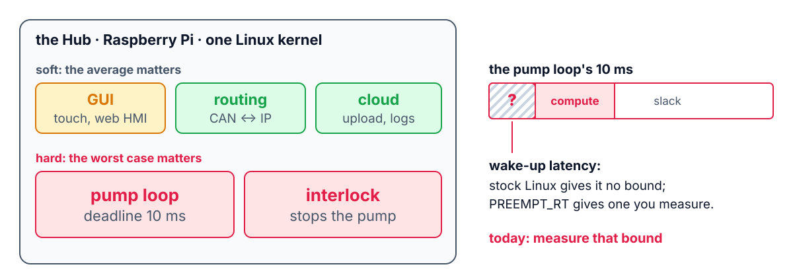

<!--
2:30–4:30. Same box, two kinds of task. GUI, routing and cloud care about the
average: a slow frame is annoying, not dangerous. The pump loop and the interlock care
about the worst case: one late wake-up eats the slack. Point at the "?" slice: that
is the whole lecture. Stock Linux gives it no bound; PREEMPT_RT gives one you can
measure. Task D asks where that bound sits against the 10 ms.
-->

---

<!-- _class: s1 figure -->
<!-- _header: 1 · Why stock Linux is late -->

## Between the timer and your thread

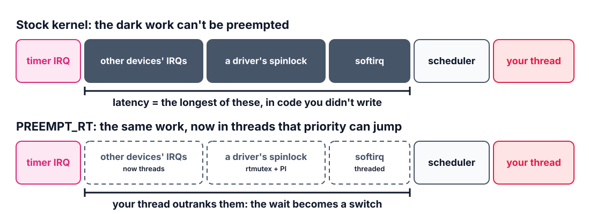

<!--
4:30–6:30. Walk the top row left to right. The timer IRQ fires on time and marks your
thread runnable; it still has to get through three kinds of work priority can't jump.
Other devices' interrupt handlers run in hard-IRQ context, above every thread. A driver
in a spinlock section has turned preemption off on that core. Softirqs (network
receive, block I/O completion, timer callbacks) run on the way out of an interrupt,
also above every thread. Latency is the longest of these, in code you didn't write. On
the MCU we owned every line; here the critical sections belong to drivers we've never
read. Week 2's latency anatomy, at a larger scale. Segment lengths are schematic.
-->

---

<!-- _class: s1 figure -->
<!-- _header: 1 · Why stock Linux is late -->

## Inside one dark box: a driver's spinlock

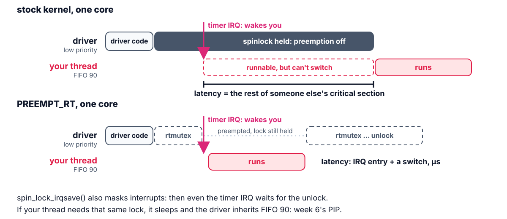

<!--
6:30–8:00. Zoom into the middle box, one core. A low-priority driver takes a spinlock:
on a stock kernel spin_lock() turns preemption off on that core, because a holder
switched out would leave every other core spinning. The timer IRQ still fires and
marks your FIFO 90 thread runnable, but the scheduler can't switch until spin_unlock()
turns preemption back on. Your latency is whatever is left of someone else's critical
section. With spin_lock_irqsave() the driver also masks interrupts, so even the timer
IRQ waits. Bottom row: on PREEMPT_RT the same spinlock_t is an rtmutex. The driver
can be preempted while holding it; your thread runs within µs. Only if you need that
same lock do you wait, and then the holder inherits your priority. Don't name the
week-6 idea yet: that's the next question.
-->

---

<!-- _class: s1 question -->
<!-- _header: 1 · Why stock Linux is late -->

## "A driver holds a spinlock while your thread waits." Which week-6 idea is that?

1. Interference from higher-priority tasks
2. Blocking: $B_i$, by code you don't control
3. Priority inversion with inheritance
4. Jitter in the release time

<!--
8:00–10:00. Answer: 2. It is a critical section of a lower-priority activity that
delays you; the difference from week 6 is that you can't bound it by reading the
code, because it isn't yours.
-->

---

<!-- _class: s2 figure -->
<!-- _header: 2 · What PREEMPT_RT changes -->

## Make almost everything preemptible

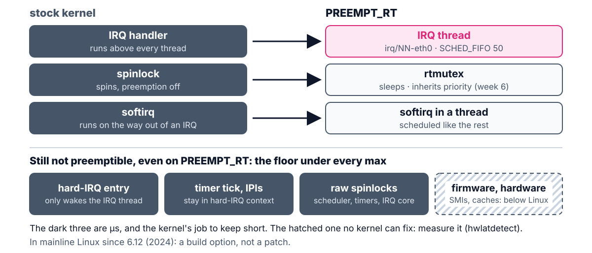

<!--
10:00–13:00. Top: back to the wake-up figure's second row, the same work made
schedulable. Interrupt handlers become kernel threads, spinlocks become rtmutexes that
sleep and inherit priority (week 6's PIP, inside the kernel), softirqs run in threads.
Bottom: what can't become a thread, and why. Someone has to wake the IRQ threads: the
hard-IRQ entry saves state, acknowledges the controller and wakes the thread, a few µs.
The timer tick and inter-core interrupts (IPIs) stay in hard-IRQ context because they
are what wakes and moves RT threads; threading them would delay the very thing we want
on time. The scheduler can't take a sleeping lock to decide who runs, so its run queues,
the hrtimer bases and the interrupt core keep raw spinlocks: short sections the kernel
developers audit and test (the RT community runs cyclictest farms on every release).
Below Linux, nothing helps: firmware interrupts that freeze the CPU (SMIs on x86, the
secure monitor on Arm) and cache or memory stalls. rt-tests ships hwlatdetect to catch
them: a board with a 300 µs SMI can't promise 100 µs, whatever kernel it runs. That
floor plus contention is the max they'll read today. Mainline since 6.12; on the Pi you
still boot a kernel built with it (SOP-09).
-->

---

<!-- _class: s2 figure -->
<!-- _header: 2 · What PREEMPT_RT changes -->

## Handlers become threads with a priority

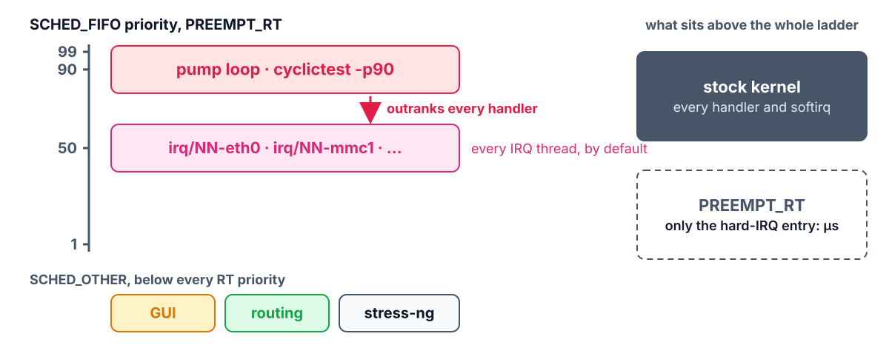

<!--
13:00–15:30. On the RT kernel every device's handler is a thread, SCHED_FIFO 50 by
default: `ps -eLo rtprio,comm | grep irq/` on the Pi shows them. That is why the lab
runs cyclictest at 90: above every handler. Your GUI, routing and the stress-ng load
sit below every RT priority. On the stock kernel the handlers aren't on this ladder
at all: they run above it. You can also move one IRQ thread with chrt: the NIC above
your loop, if the network matters more. That is a design decision now, not luck.
-->

---

<!-- _class: s2 question -->
<!-- _header: 2 · What PREEMPT_RT changes -->

## RT kernel: the pump loop runs at FIFO 90, the NIC's IRQ thread at FIFO 50. A ping flood arrives. What does the pump loop see?

1. Every packet's handler delays it
2. Only the hard-IRQ entry; the packets wait in their thread
3. Nothing: the NIC drops the flood
4. The same as on the stock kernel

<!--
15:30–17:30. Answer: 2. The hard-IRQ entry still runs first (it only wakes the IRQ
thread: µs), and the rest of the handler waits for a priority-50 slot. 1 and 4 are the
stock kernel. 3: the NIC queues; nothing is dropped until its ring fills, and the
packets are served once the pump loop sleeps.
-->

---

<!-- _class: s2 figure -->
<!-- _header: 2 · What PREEMPT_RT changes -->

## Faster on average is not the goal

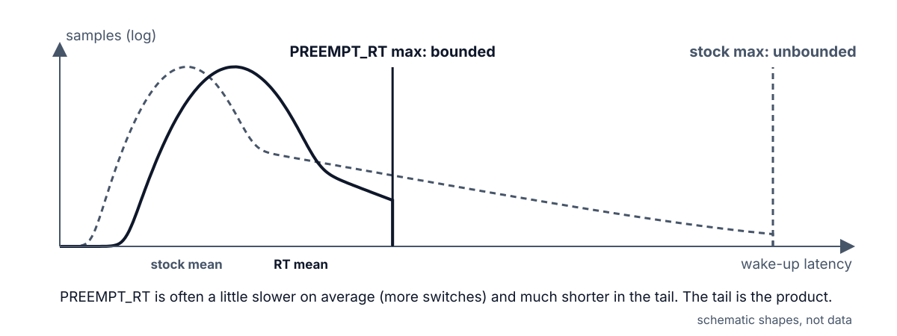

<!--
17:30–19:00. Misconception to anticipate: "the RT kernel makes Linux faster".
Throughput usually gets worse: more preemption, more switches. It trades average
performance for a bounded tail. If the mean improves and the max doesn't, you got
nothing. Shapes are schematic.
-->

---

<!-- _class: s3 figure -->
<!-- _header: 3 · cyclictest -->

## What cyclictest measures

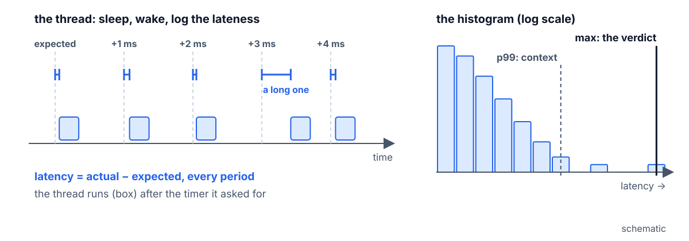

<!--
19:00–21:00. A thread sleeps to an absolute time (clock_nanosleep), wakes, logs actual
minus expected, sleeps again: 1000 times a second. It does no work, so all of what it
logs is the kernel's delay. The histogram is the kernel's promise, measured. Read it
from the right: the max is the verdict, the p99 is context.
-->

---

<!-- _class: s3 figure -->
<!-- _header: 3 · cyclictest -->

## The instrument, flag by flag

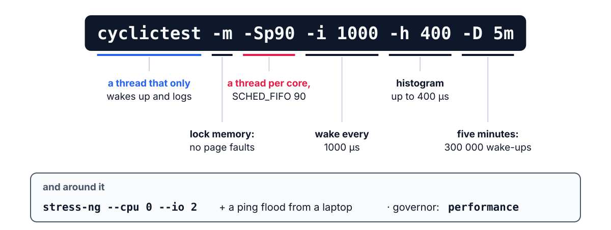

<!--
21:00–25:30. -m locks memory: no page faults during the run. -S starts one thread per
core, each pinned, and -p90 puts them at FIFO 90, above every IRQ thread. -h 400 keeps a
histogram up to 400 µs (anything later counts as overflow). The load: stress-ng on CPU
and I/O plus a ping flood from a laptop: real interrupts, not just busy cores.
Governor locked to performance; the DFS row shows why. Live demo here (22:00–25:30), on the
laptop's stock kernel, one thread so the line fits on screen: idle at FIFO 90, then under
stress-ng at normal priority, then under stress-ng at FIFO 90. Read the Max column each
time: run 2 against run 3 is the priority ladder; run 3's leftover tail is the stock
kernel's non-preemptible work, which PREEMPT_RT removes.
-->

---

<!-- _class: s3 figure -->
<!-- _header: 3 · cyclictest -->

## The max needs minutes and load to show up

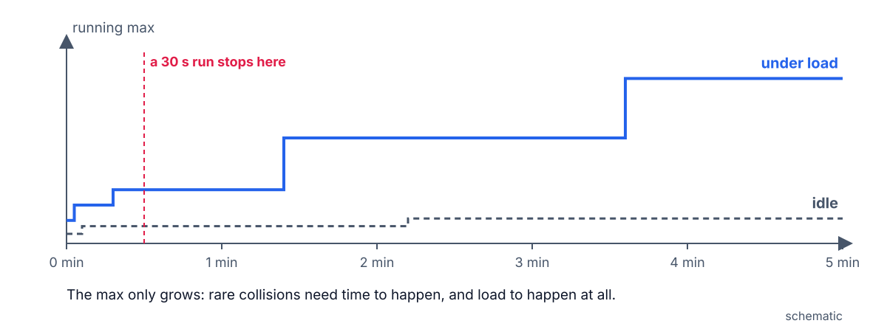

<!--
25:30–27:00. The running max is a staircase that only climbs. The collisions that make
the tail are rare: a 30 s run often stops before the first big step, and an idle box
may never take it. Five minutes at 1 kHz is 300 000 wake-ups per core. Production
qualification runs hours, or days. Schematic.
-->

---

<!-- _class: s3 question -->
<!-- _header: 3 · cyclictest -->

## Five minutes, idle: max 40 µs. What may you promise for the pump loop?

1. 40 µs, with margin
2. Nothing yet: no load, too short
3. 40 µs × 2, the usual safety factor
4. The p99, since the max is an outlier

<!--
27:00–28:30. Answer: 2. The tail comes from contention; an idle box has none. 4 is
the soft-real-time habit this course unlearns: the max is not an outlier, it is the
answer.
-->

---

<!-- _class: s4 figure -->
<!-- _header: 4 · The scale change -->

## Same theory, two orders of magnitude

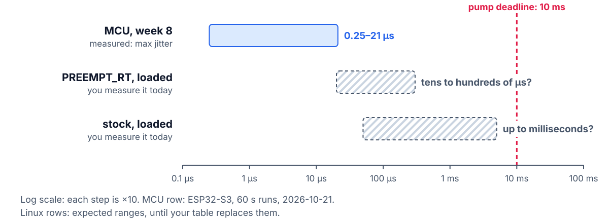

<!--
28:30–31:00. MCU (weeks 2–8): the worst case comes from a small kernel you can read,
µs; the bar is our own week-8 measurement. RT Linux: from a giant one, tens to hundreds
of µs, even with PREEMPT_RT; stock under load can reach milliseconds. The hatched bands
are what we expect: the lab's table replaces them. That gap is the number the Hub's
partitioning ADR is built on. What about FreeRTOS? Same question at the MCU's scale:
FreeRTOS or Zephyr, the worst case came from a small kernel.
-->

---

<!-- _class: s4 figure -->
<!-- _header: 4 · The scale change -->

## Frequency scaling stretches the path

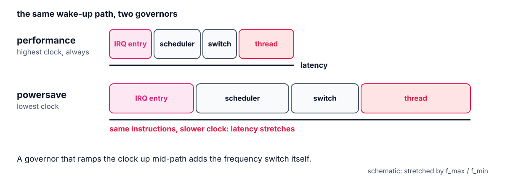

<!--
31:00–32:30. MCUs rarely scale their clock; Linux SBCs do by default. At the lowest
clock every instruction on the wake-up path takes longer, and a governor that ramps up
mid-path adds the frequency switch itself. That is row 5 of the lab, and why every
official run locks the governor to performance first. Schematic.
-->

---

<!-- _class: takeaway -->

## The one thing to remember

> PREEMPT_RT doesn't make Linux fast; it makes its worst case boundable. Measure that worst case under load, for minutes, and read the max.

<!--
32:30–33:00.
-->

---

<!-- _class: s5 figure -->
<!-- _header: 5 · Lab -->

## Today in the lab: predict five maxima

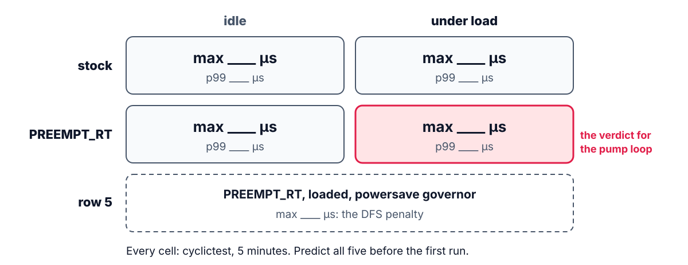

<!--
33:00–36:00. Predictions to write down: stock-loaded's max is the scary one;
RT-loaded lands well under the pump loop's 10 ms, but nowhere near week 8's µs.
SOP-09 has the image, the commands and the plot script.
-->

---

## References

- Buttazzo, §13.3.4–13.3.5
- Linux kernel docs: *Real-time preemption* (PREEMPT_RT); `rt-tests` (cyclictest)
- SOP-09: the image, the runs, the histogram script

<!--
36:00–40:00. Questions, then SBC bring-up.
-->
